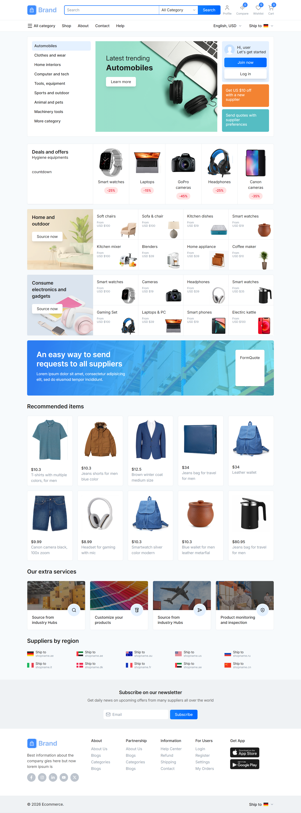
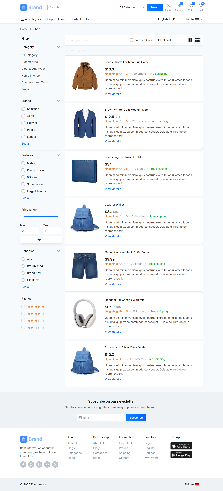
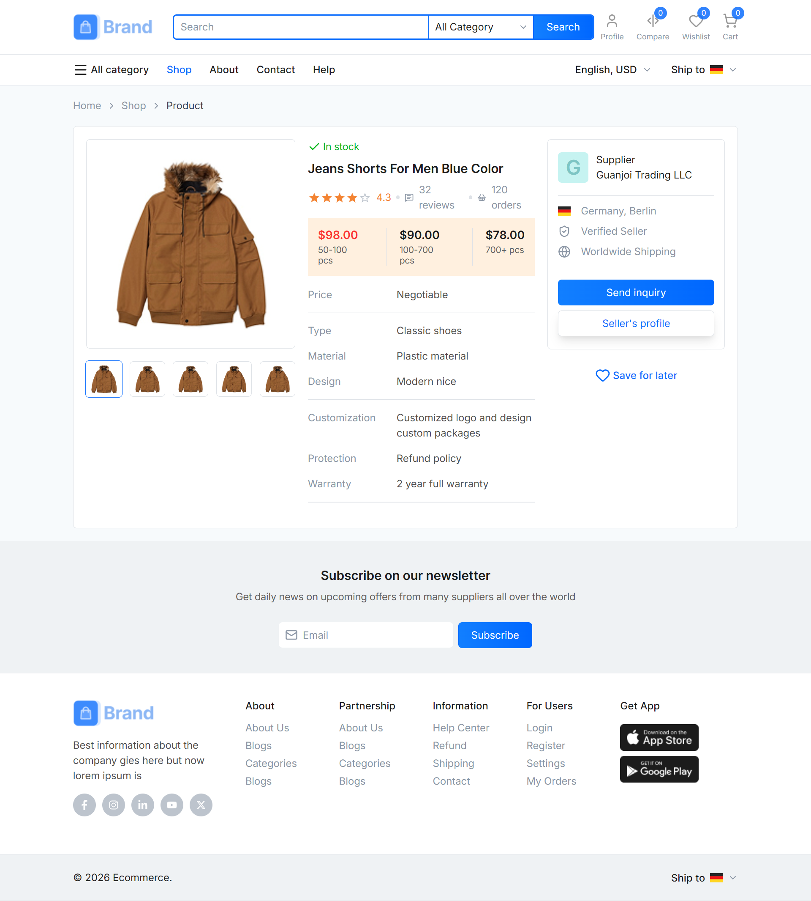

# 🚀 Brand Ecom – B2B/B2C Marketplace Storefront

<p align="center">

  

  

  

  

  

  

  

  

</p>

## 📌 Overview

Brand Ecom is a responsive marketplace storefront built with React 19, TypeScript, and Redux Toolkit, implemented from a Figma design.

It covers the core shopping flow: browse and filter products, open product details, manage a persistent cart and favourites, and place orders. Everything runs client-side.

<p align="center">

  

</p>

## 🎯 Problem

- ❌ Marketplace filters that fight each other (sliders, inputs, chips out of sync)

- ❌ Cart and favourites state lost on refresh

- ❌ Business logic buried inside UI components

- ❌ Inconsistent types and styling across pages

## 💡 Solution

- ✅ Filtering logic extracted into focused custom hooks

- ✅ Redux Toolkit for shared, persisted domain state

- ✅ Context + `useReducer` only for UI state (portals, currency, sort, view mode)

- ✅ One shared product type and Tailwind v4 design tokens across the app

## ⚡ Key Features

- 🔍 Multi-filter shop: category, brand, features, condition, rating, verified-only, dual-thumb price slider

- 🏷️ Removable filter chips with clear-all, derived from filter state

- ↕️ Sorting and grid/list view toggle

- 🛒 Persistent cart, favourites, and order history (`localStorage` + rehydration)

- 🧾 Order placement from cart or favourites (UUID, timestamp, computed total)

- 💵 Billing selectors: subtotal, tiered delivery fee, tax, grand total

- 🪟 Slide-in portals for cart, favourites, and orders (Esc-to-close, scroll lock)

- 🧭 Route-driven breadcrumbs via React Router `handle` + `useMatches`

- 🔔 Toast feedback on every cart, favourites, and order action

- 📱 Fully responsive header, sidebar, and layouts

## 🛠 Tech Stack

- ⚛️ React 19 + TypeScript

- ⚡ Vite

- 🎨 Tailwind CSS v4 (`@theme` tokens)

- 🗂 Redux Toolkit + React Redux

- 🧭 React Router v7 (`createBrowserRouter`, nested layouts)

- 🔔 react-toastify

- 🎯 lucide-react, react-icons

- 🧩 clsx + tailwind-merge

## 🧠 Engineering Decisions

- **Redux for domain state, Context for UI state:** cart, favourites, and orders are shared and persisted. "Is the cart portal open" is not.

- **One `use*Actions` hook per slice:** dispatch and toast live together, so components never touch `dispatch` directly.

- **Derived, not duplicated:** memoized `createSelector` selectors compute billing totals instead of storing them twice.

- **Filtering lives in hooks:** `useFilteredProducts` is a single `useMemo` over filter state and sort key. Chips and handlers are separate hooks.

- **Single source of truth for types:** one product interface backs cart, favourites, and orders.

- **Typed store hooks:** `useSelector.withTypes` / `useDispatch.withTypes`.

## 📈 Results / Impact

- 🚀 Complete shopping flow: browse, filter, cart, favourites, order

- 🧱 Business logic separated from UI through hooks and selectors

- 💾 State survives refresh via persistence and rehydration

- 🎯 Scalable structure ready for an API layer

## 📸 Project Preview

### 🏠 Home


### 🛍️ Shop



### 📦 Product Detail



## 📂 Folder Structure

```text
src/
├── components/   common/ · home/ · shop/ · footer/
├── pages/
├── layouts/
├── routes/
├── redux/        features/{cart,favs,orders}
├── context/
├── hooks/
├── types/
├── data/
├── utils/
└── styles/
```

## ⚙️ Installation

```bash
git clone https://github.com/aliiashraf777/1rts-brand-ecom-app.git

cd 1rts-brand-ecom-app

npm install

npm run dev
```

## 🔗 Live Demo

https://1rts-brand-ecom-app.vercel.app/

## 💻 Repository

https://github.com/aliiashraf777/1rts-brand-ecom-app

## 🚀 Future Improvements

- Checkout and cart pages (cart currently lives in the portal)

- Authentication (login/register are placeholders)

- Wire up header search

- Replace static data with an API layer (RTK Query)

- Tests with Vitest + React Testing Library

## 🧠 What I Learned

- Deciding where state lives: Redux vs Context

- Building filter systems without state drift

- Persisting and rehydrating Redux state safely

- Structuring a Tailwind v4 token-based design system

## ⭐ Support

Give it a star if you like it ⭐
